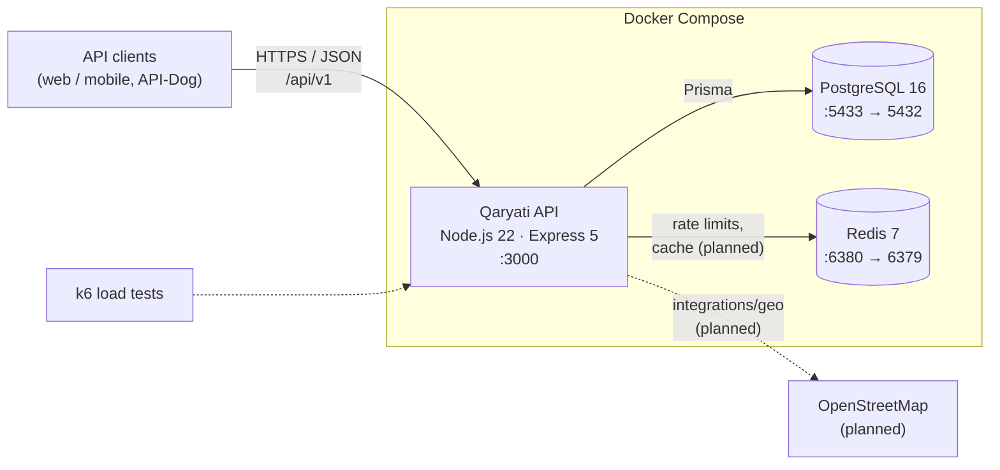
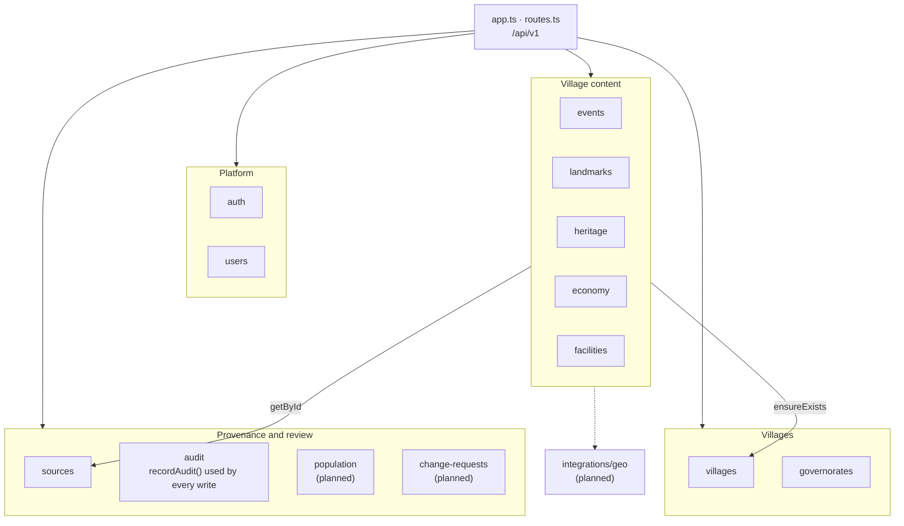
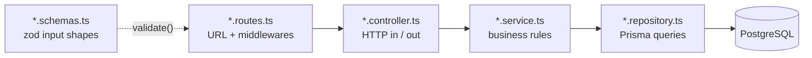
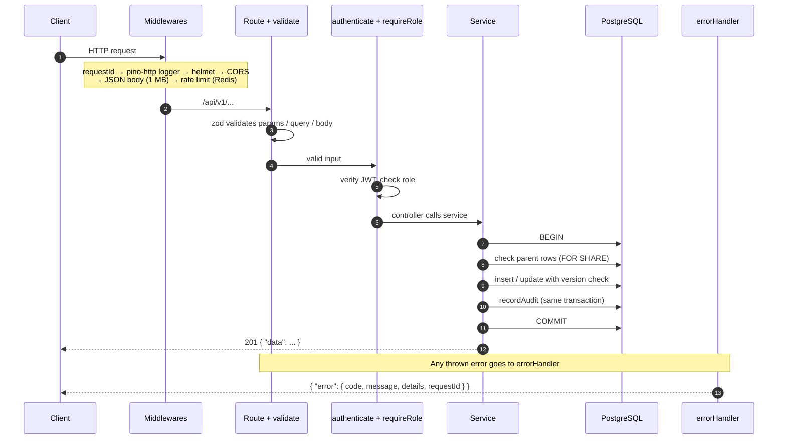

# Architecture

Qaryati is a **modular monolith**: one Node.js + Express + TypeScript service, split into feature modules that each own their routes, logic and data access ([ADR 0003](adr/0003-modular-monolith.md)).
It runs with PostgreSQL and Redis through Docker Compose. Database tables are described in [erd.md](erd.md).

Items marked *planned* are agreed in the team guide but not merged yet.

## 1. System context

| Service | From your machine | Inside Docker |
|---|---|---|
| API | `localhost:3000` | `app:3000` |
| PostgreSQL | `localhost:5433` | `postgres:5432` |
| Redis | `localhost:6380` | `redis:6379` |

Host ports can be changed in `.env` with `APP_HOST_PORT`, `POSTGRES_HOST_PORT` and `REDIS_HOST_PORT`.

## 2. Modules

Every module lives in `src/modules/<name>` and only reaches another module through that module's service (for example `villageService.ensureExists`), never its repository.

All modules also use `src/shared/`: `db` (Prisma), `cache` (Redis), `logger`, `errors`, `pagination`, and the middlewares `requestId`, `validate`, `authenticate`, `requireRole`, `rateLimit` and `errorHandler`.

| Owner | Modules |
|---|---|
| Hala | `auth`, `users`, `shared/`, project setup, database schema and seed |
| Yaman | `villages`, `governorates`, Redis cache, k6 read tests |
| Sara | `sources`, `audit`, `population`, `change-requests`, k6 write tests |
| Zeina | `events`, `landmarks`, `heritage`, `economy`, `facilities`, `integrations/geo` |

## 3. Layers inside a module

| File | Responsibility |
|---|---|
| `*.routes.ts` | Declares endpoints and their middleware chain |
| `*.controller.ts` | Reads the validated request, calls the service, sends the response. No business logic |
| `*.service.ts` | Rules such as "village must exist", version checks, audit logging |
| `*.repository.ts` | The only layer that talks to the database |
| `*.schemas.ts` | zod schemas for params, query and body |

## 4. Request lifecycle

A write request, for example `POST /api/v1/villages/:villageId/landmarks`:

Read endpoints are public and skip `authenticate`. A transaction makes the change and its audit row succeed or fail together.

## 5. API conventions

| Topic | Rule |
|---|---|
| Base path | `/api/v1` |
| List response | `{ "data": [...], "meta": { page, limit, total, totalPages, hasNextPage, hasPrevPage } }` |
| Single item | `{ "data": { ... } }` |
| Errors | `{ "error": { code, message, details: [{ field, message }], requestId } }` |
| Pagination | `page` (default 1), `limit` (default 20, capped at 100) |
| Request ID | `X-Request-Id` header on every response; also in logs and audit rows |
| Health | `GET /api/v1/health` returns `200` or `503` with `db` and `redis` status |
| Roles | Visitor reads; `EDITOR` adds; `REVIEWER` verifies; `ADMIN` deletes and manages users |
| Conflicts | Updates send the `version` they read; a stale version returns `409 CONFLICT` |

## 6. Security

- Passwords hashed with bcrypt (`bcryptjs`); access tokens are short-lived JWTs (HS256); refresh tokens are random, stored only as SHA-256 hashes, and rotated on use ([ADR 0004](adr/0004-authentication-tokens.md)).
- `helmet` security headers, configurable CORS, `x-powered-by` disabled, 1 MB body limit.
- Rate limits stored in Redis: a global API limit plus stricter limits on login, register and refresh. `/health` is not limited.
- Server errors return a generic message; details stay in the logs. The `Authorization` header is redacted from logs.
