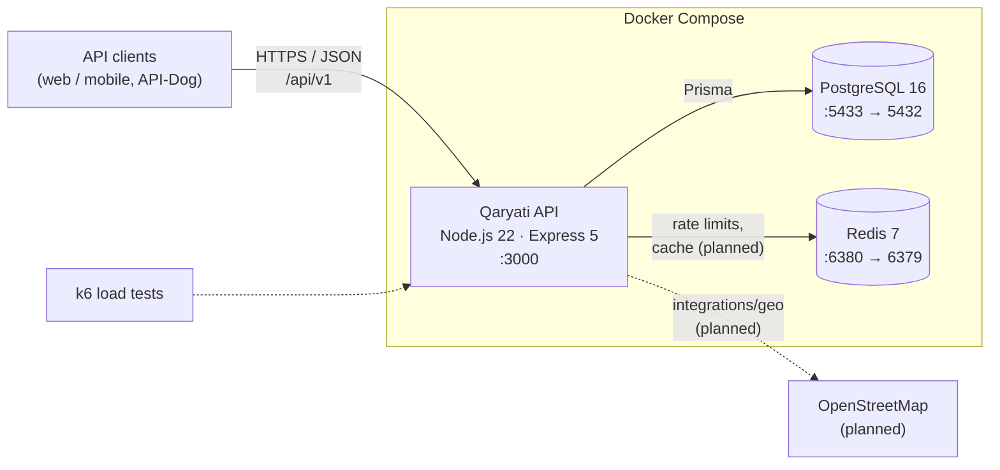
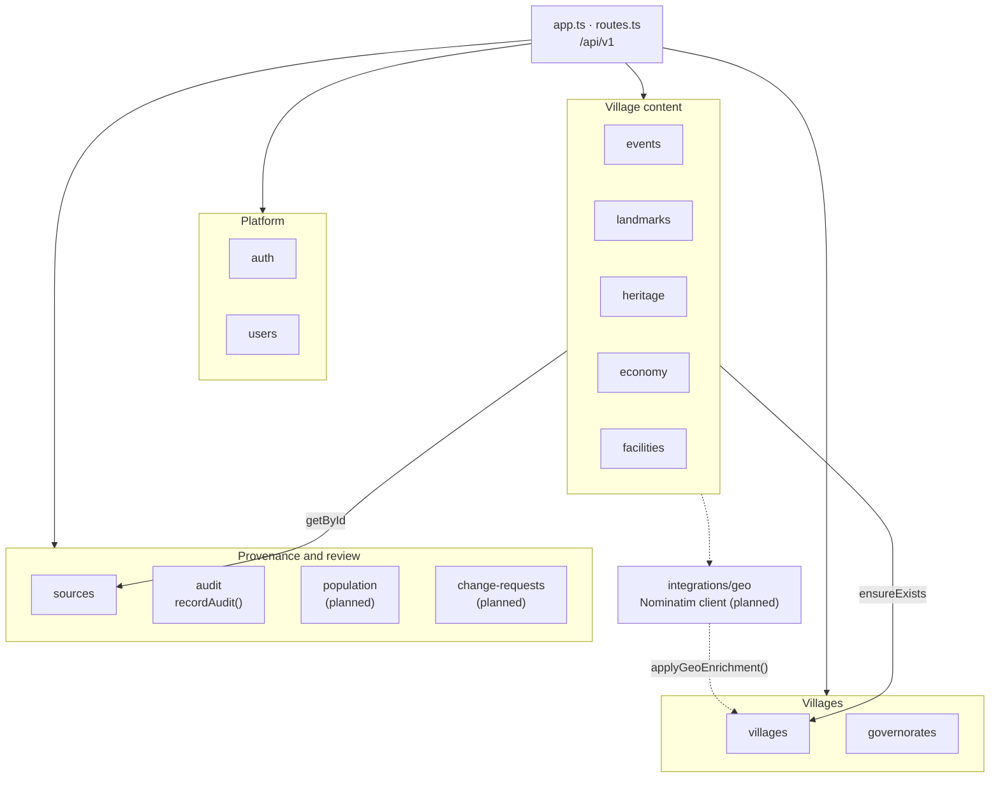
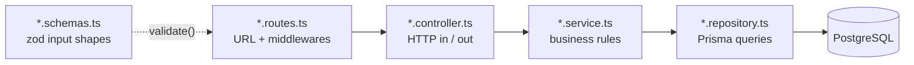
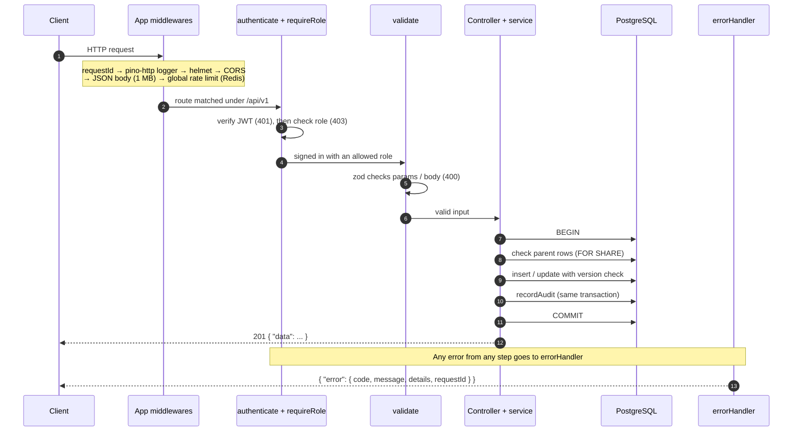

# Architecture

Qaryati is a **modular monolith**: one Node.js + Express + TypeScript service, split into feature modules that each own their routes, logic and data access ([ADR 0003](adr/0003-modular-monolith.md)).
It runs with PostgreSQL and Redis through Docker Compose. Database tables are described in [erd.md](erd.md).

Items marked *planned* are agreed in the team guide but not merged into `main` yet. This page describes `main` at commit `dec2f22` (2026-11-23); it is refreshed with the final README.

## 1. System context

| Service | From your machine | Inside Docker |
|---|---|---|
| API | `localhost:3000` | `app:3000` |
| PostgreSQL | `localhost:5433` | `postgres:5432` |
| Redis | `localhost:6380` | `redis:6379` |

Host ports can be changed in `.env` with `APP_HOST_PORT`, `POSTGRES_HOST_PORT` and `REDIS_HOST_PORT`.

## 2. Modules

Every module lives in `src/modules/<name>` and only reaches another module through that module's service (for example `villageService.ensureExists`), never its repository.

All modules also use `src/shared/`: `db` (Prisma), `cache` (Redis), `logger`, `errors`, `pagination`, and the middlewares `requestId`, `validate`, `authenticate`, `requireRole`, `rateLimit` and `errorHandler`.

| Owner | Modules |
|---|---|
| Hala | `auth`, `users`, `shared/`, project setup, database schema and seed |
| Yaman | `villages`, `governorates`, Redis cache, k6 read tests |
| Sara | `sources`, `audit`, `population`, `change-requests`, k6 write tests |
| Zeina | `events`, `landmarks`, `heritage`, `economy`, `facilities`, `integrations/geo` |

## 3. Layers inside a module

| File | Responsibility |
|---|---|
| `*.routes.ts` | Declares endpoints and their middleware chain |
| `*.controller.ts` | Reads the validated request, calls the service, sends the response. No business logic |
| `*.service.ts` | Rules such as "village must exist", version checks, and calling `recordAudit()` |
| `*.repository.ts` | Talks to the database |
| `*.schemas.ts` | zod schemas for params, query and body |

Exceptions to the layering:
- `GET /api/v1/health` lives in `src/routes.ts` and calls Prisma (`SELECT 1`) and Redis (`PING`) directly, without a module or repository, because it only checks that the dependencies answer.
- `sources` and `users` call `recordAudit()` from their repository, inside the same transaction as the write; `landmarks`, `economy` and `facilities` call it from the service with the transaction client.

## 4. Request lifecycle

A write request, for example `POST /api/v1/villages/:villageId/landmarks`:

This order applies to the **protected write routes** (content writes and the `users` routes): `authenticate` → `requireRole(...)` → `validate(...)` → controller, so an anonymous or unauthorised request gets `401` / `403` before its body is checked. The `users` router applies `authenticate` and `requireRole('ADMIN')` once, to all its routes.

The auth routes are different:
- `POST /auth/register`, `/auth/login` and `/auth/refresh`: their own rate limiter → `validate` → controller (no `authenticate`).
- `POST /auth/logout`: `validate` → controller (no `authenticate`; the refresh token in the body identifies the session).
- `GET /auth/me`: `authenticate` → controller (no role check, no body).

Which routes need a token:
- **Public:** all content reads (villages, governorates, sources, events, landmarks, heritage, economy, facilities), `/health`, and `POST /auth/register`, `/auth/login`, `/auth/refresh`, `/auth/logout`.
- **Signed in:** `GET /auth/me`, and every create / update on content (`EDITOR`, `REVIEWER`, `ADMIN`).
- **`ADMIN` only:** `GET /users`, `GET /users/:id`, `PATCH /users/:id/role`, `PATCH /users/:id/status`, and deletes.

Audit: these writes add an audit row in the same transaction as the change, so both succeed or fail together:
- villages: create, update, delete, verify, reject, and geo enrichment (`after.source = 'geo-enrichment'`)
- village relations: alternate names (add, update, delete) and nearby places (add, delete)
- sources, landmarks, economy and facilities: their writes
- users: role and status changes

Auth actions (register, login, refresh, logout) do not write audit rows.

## 5. API conventions

| Topic | Rule |
|---|---|
| Base path | `/api/v1` |
| List response | `{ "data": [...], "meta": { page, limit, total, totalPages, hasNextPage, hasPrevPage } }` |
| Single item | `{ "data": { ... } }` |
| Errors | `{ "error": { code, message, details: [{ field, message }], requestId } }` |
| Pagination | `page` (default 1), `limit` (default 20, capped at 100) |
| Request ID | `X-Request-Id` header on every response; also in logs and audit rows |
| Health | `GET /api/v1/health` returns `200` or `503` with `db` and `redis` status |
| Roles | Visitor reads; `EDITOR` adds (as `PENDING`); `REVIEWER` verifies or rejects; `ADMIN` also deletes and manages users. The full matrix is in the team guide |
| Conflicts | Endpoints that implement optimistic locking require the `version` the client read and return `409 CONFLICT` when it is stale. On `main`: sources update / delete (`expectedVersion`), village update / verify / reject and alternate-name update (`version`), and geo enrichment when called with `expectedVersion`. These writes increment `version`. Village and alternate-name deletes and nearby-place writes neither check nor increment it. The column alone does not prevent overwrites |

### Merged vs planned workflows

| Workflow | On `main` | Planned |
|---|---|---|
| Content creation (`PENDING`) with audit | villages, alternate names, nearby places, sources, landmarks, economy, facilities | population |
| Update with role and ownership rules (`EDITOR`: own `PENDING` only) | villages, alternate names | other content |
| Verify / reject endpoints | villages | population, other content |
| Geo enrichment | `villageService.applyGeoEnrichment()` (no route) | Nominatim client in `integrations/geo` |
| Population records (multiple sources per year) | Table and constraints only | Read and create endpoints, automatic `needs_review` |
| Choosing the preferred population record | Table and constraint only (`is_preferred`) | Reviewer endpoint |
| Change requests for edits to `VERIFIED` data | Table only | Endpoints and review flow |

## 6. Security

- Passwords hashed with bcrypt (`bcryptjs`); access tokens are short-lived JWTs (HS256); refresh tokens are random, stored only as SHA-256 hashes, and rotated on use ([ADR 0004](adr/0004-authentication-tokens.md)).
- `helmet` security headers, configurable CORS, `x-powered-by` disabled, 1 MB body limit.
- Rate limits stored in Redis: a global API limit plus stricter limits on login, register and refresh. `/health` is not limited. Limits and windows are set with the `*RATE_LIMIT*` variables; see [security.md](security.md#rate-limiting).
- The API itself serves plain HTTP on port 3000. In a deployment, HTTPS is expected to be terminated by a reverse proxy in front of it; set `TRUST_PROXY=true` only in that case so rate limits use the real client IP.
- Server errors return a generic message; details stay in the logs. The `Authorization` header is redacted from logs.
