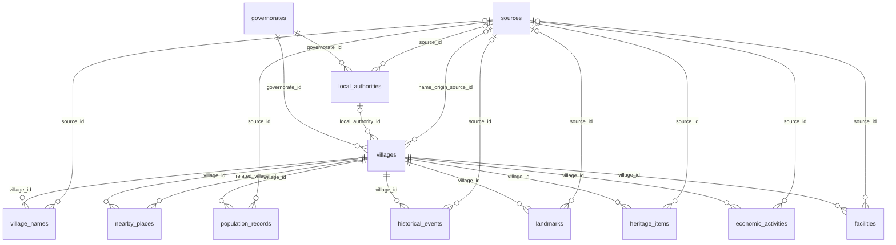
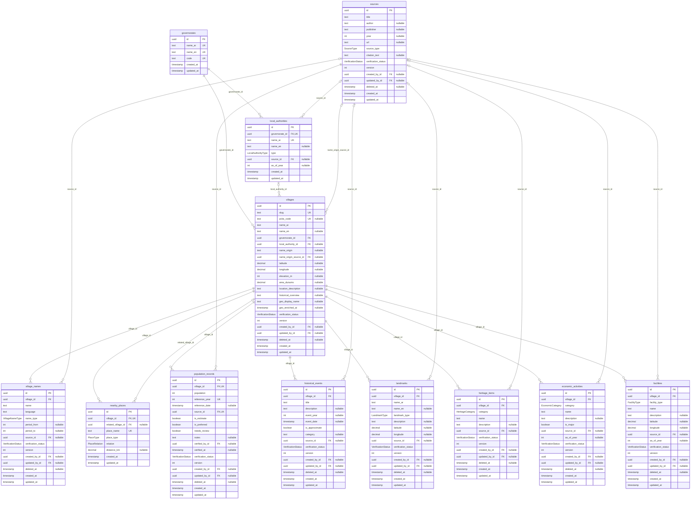
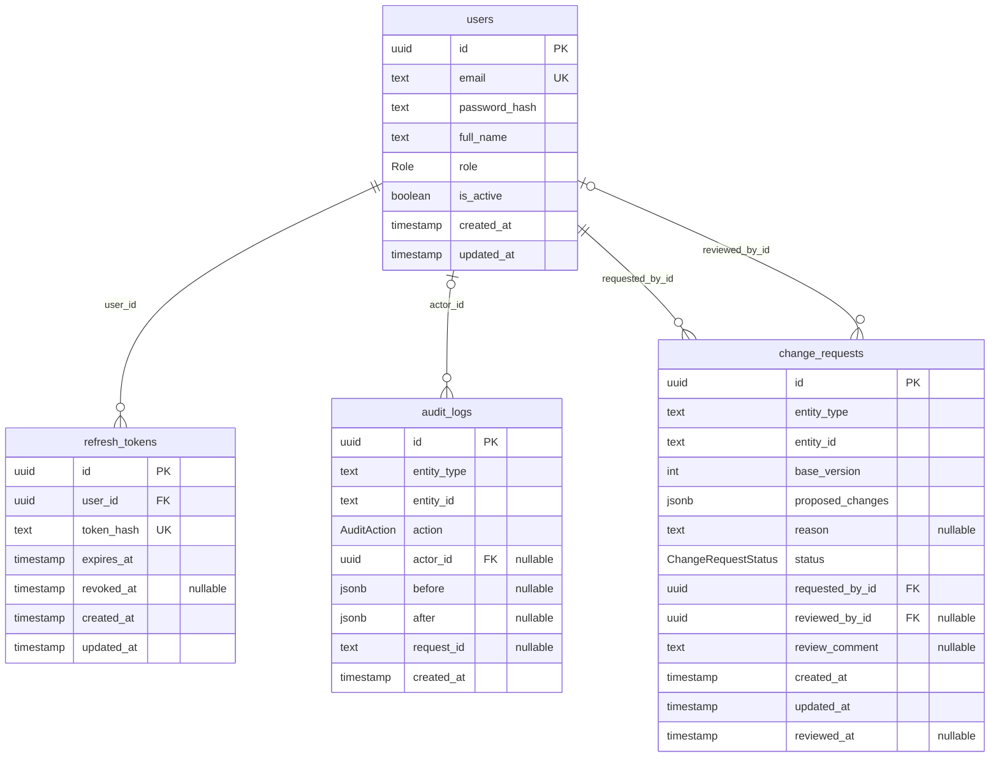

# Entity Relationship Diagram

Generated from [`prisma/schema.prisma`](../prisma/schema.prisma): 16 tables, PostgreSQL 16.
GitHub renders the diagrams below. To export an image, paste a diagram into <https://mermaid.live>.

Notation: `||--o{` is one-to-many with a required parent, `|o--o{` is one-to-many with an optional parent (nullable foreign key).
`PK` primary key, `FK` foreign key, `UK` unique (alone or as part of a composite unique key).

## 1. Overview

How the content tables connect. `villages` is the centre of the model, and `sources` gives every fact its provenance.

## 2. Content tables

All columns of the geography and village content tables.

Shared columns on content tables:

| Column | Purpose |
|---|---|
| `verification_status` | `PENDING`, `VERIFIED` or `REJECTED`; new content starts as `PENDING` |
| `version` | Optimistic locking: an update must send the version it read, otherwise `409 Conflict` |
| `deleted_at` | Soft delete; rows are hidden, not removed |
| `created_by_id`, `updated_by_id` | References to `users` (lines omitted above to keep the diagram readable) |
| `source_id` | Reference to `sources` for provenance |

`population_records` also has `verified_by_id` referencing `users`, and requires a `source_id`.
Its unique key is (`village_id`, `reference_year`, `source_id`): several sources can report the same year, and a reviewer marks one as `is_preferred`.

## 3. Users, authentication, audit and change requests

- `refresh_tokens` stores only a SHA-256 hash of each token; rotation revokes the old row.
- `audit_logs` is append-only (no `updated_at`). `entity_type` + `entity_id` point to any table, so they are not foreign keys.
- `change_requests` uses the same polymorphic `entity_type` + `entity_id`, plus `base_version` to detect edits made in the meantime.

## Referential rules

- Every foreign key uses `ON DELETE RESTRICT`: a parent cannot be hard-deleted while rows reference it. Content is removed by soft delete instead.
- Reference tables (`governorates`, `local_authorities`) have no `deleted_at`; see [ADR 0001](adr/0001-reference-tables-read-only.md).
